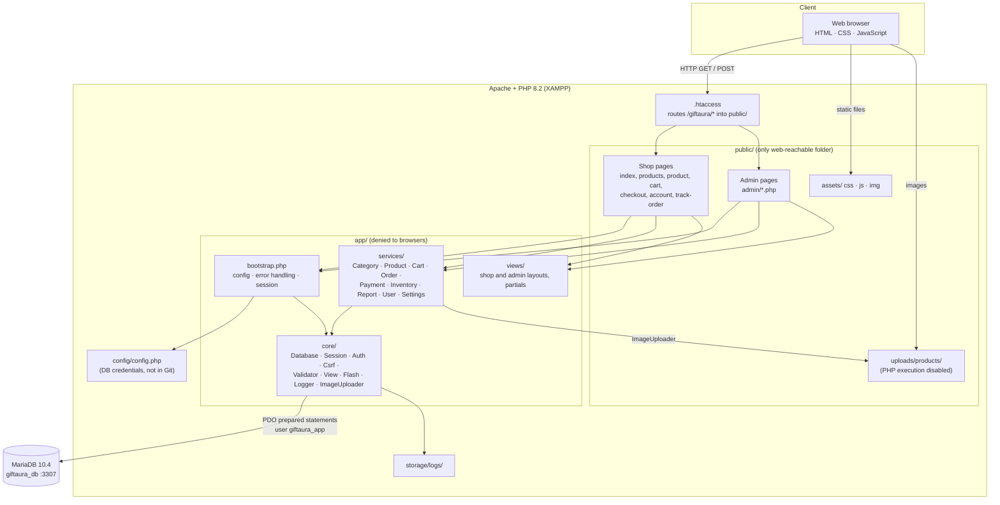
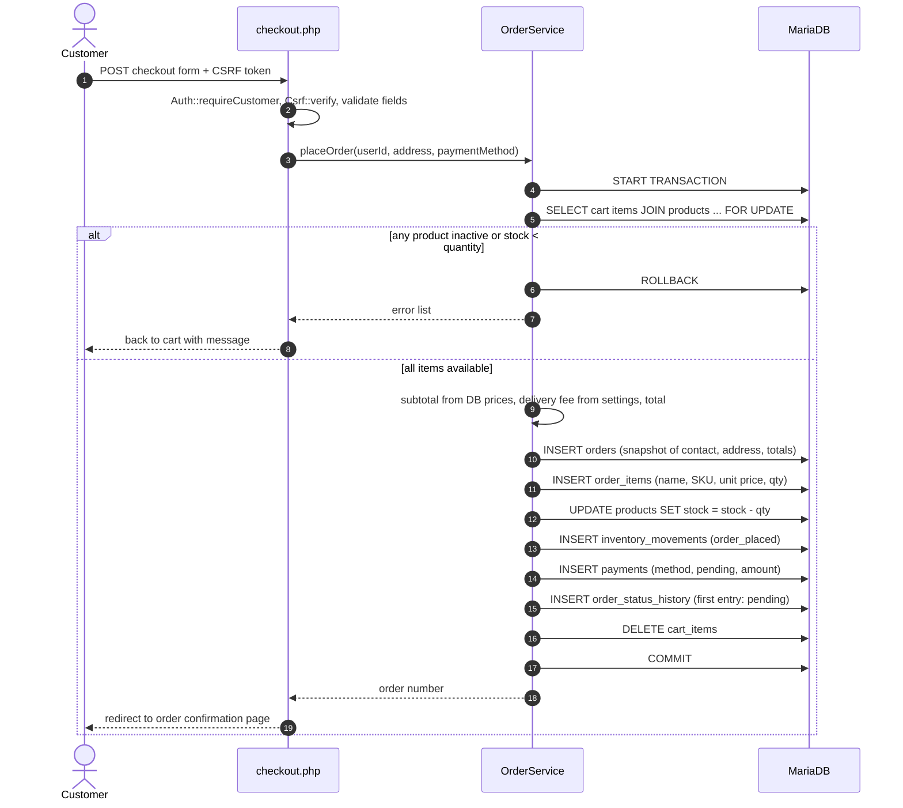
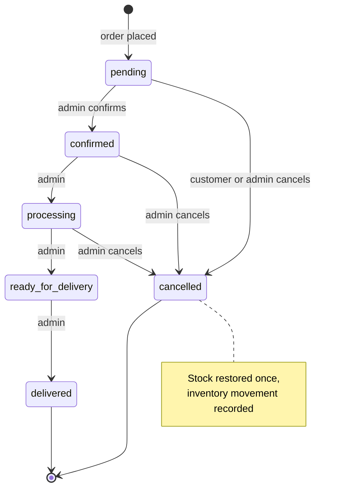
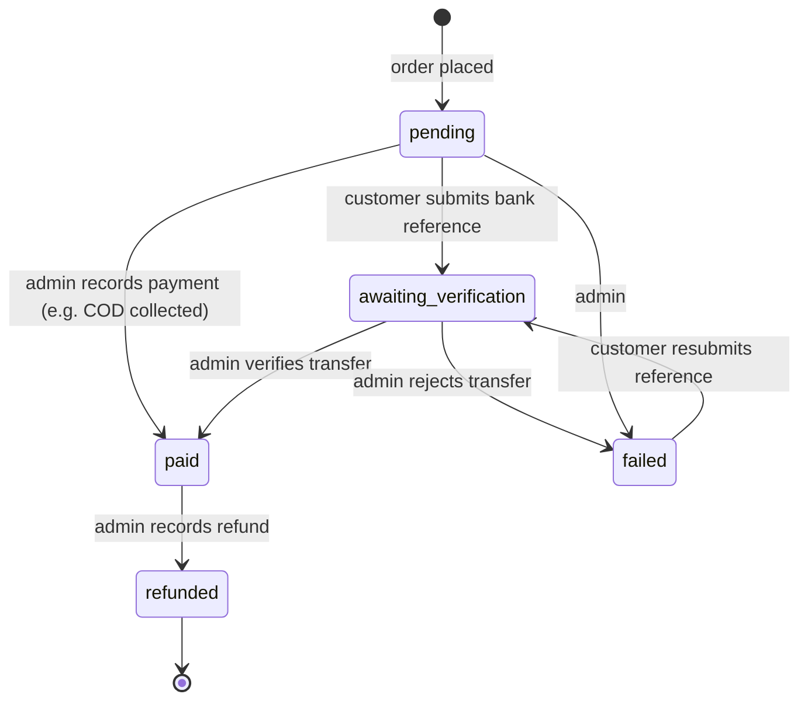

# GiftAura — System Architecture

Version 1.0 — Phase 2 (design). Diagrams are written in Mermaid. To see them as pictures, open `docs/diagrams.html` in a browser (double-click the file), or paste a diagram into <https://mermaid.live> to export a PNG for the project report.

## 1. Architectural style

GiftAura is a **server-rendered, three-tier web application** using the **page-controller pattern**:

| Tier | Technology | Responsibility |
|---|---|---|
| Presentation | HTML5 templates, CSS3, vanilla JavaScript | Pages, forms, responsive layout, small enhancements (quantity steppers, image preview, confirm dialogs). JavaScript is never relied on for security. |
| Application | PHP 8.2 on Apache (XAMPP) | Each page in `public/` is a thin controller: it checks access, validates input, calls a service, then renders a template. Business rules live in `app/services/`. |
| Data | MariaDB 10.4 (InnoDB) | Persistent storage, foreign keys, CHECK constraints, transactions and row locks. |

Why this style: it fits the mandated stack exactly (no framework, no Composer), every page is easy to trace for marking and debugging, and keeping rules in services means the same code serves both customer and admin pages.

## 2. Component diagram

## 3. Request lifecycle (every page)

1. Apache receives `http://localhost/giftaura/<page>.php`; the root `.htaccess` maps it to `public/<page>.php`.
2. The page includes `app/bootstrap.php`, which loads `config/config.php`, sets the time zone (Asia/Colombo), installs error/exception handlers, and starts a hardened session.
3. Access check: `Auth::requireCustomer()` or `Auth::requireAdmin()` for protected pages (redirect to login or HTTP 403).
4. On POST: `Csrf::verify()` → `Validator` checks input → a service method runs (inside a transaction when it changes stock, orders or payments) → flash message → redirect (Post/Redirect/Get, so refresh never resubmits a form).
5. On GET: the service fetches data → `View::render()` outputs a template; every value is escaped with `e()`.
6. Any uncaught error is logged to `storage/logs/` and the user sees a generic error page.

## 4. Order placement sequence

Key safety points: totals come only from database prices; the `FOR UPDATE` lock stops two customers buying the last item at the same time; the CHECK constraint `stock_quantity >= 0` is a final safeguard.

## 5. Order status state machine

## 6. Payment status state machine

## 7. Security architecture

| Layer | Control |
|---|---|
| Web server | Root `.htaccess` sends all requests into `public/`; `Require all denied` in `app/`, `config/`, `sql/`, `storage/`, `scripts/`, `docs/`; `uploads/` refuses to run PHP and only serves images. |
| Session | `HttpOnly`, `SameSite=Lax`, `use_strict_mode`, `use_only_cookies`; ID regenerated on login and privilege change; idle timeout; logout destroys session and cookie. |
| Request | CSRF token on every POST form; POST required for every change; Post/Redirect/Get. |
| Access | `Auth::requireAdmin()` on every admin page and action; order and address queries always include `WHERE user_id = :current_user`. |
| Input | `Validator` (types, lengths, email, phone, enum values, numeric ranges); IDs cast to int; whitelist for sort and filter options. |
| Output | `e()` = `htmlspecialchars(…, ENT_QUOTES, 'UTF-8')` on every printed value; `Content-Security-Policy`, `X-Frame-Options`, `X-Content-Type-Options` headers. |
| Database | PDO, real prepared statements (`ATTR_EMULATE_PREPARES = false`), least-privilege user, transactions, foreign keys, CHECK constraints. |
| Files | Size limit, extension + `finfo` MIME + `getimagesize` checks, GD re-encode (removes hidden payloads), random 32-character file names. |
| Abuse | Login rate limiting via `login_attempts`. |
| Errors | `display_errors` off in the app; errors logged without passwords, tokens or bank data. |

## 8. Deployment view (development laptop)

| Item | Value |
|---|---|
| Web root | `C:\xampp\htdocs\giftaura\` (served at `http://localhost/giftaura/`) |
| PHP | 8.2.12, extensions: pdo_mysql, mbstring, fileinfo, openssl, gd |
| Database | MariaDB 10.4.32 on `127.0.0.1:3307`, database `giftaura_db`, user `giftaura_app` |
| Admin tool | phpMyAdmin 5.2.1 at `http://localhost/phpmyadmin` |
| Version control | Git 2.55, one commit per completed phase |
