# GiftAura — Database Design and ER Diagram

Version 1.0 — Phase 2. The authoritative definition is `sql/schema.sql`; this document explains it. Open `docs/diagrams.html` to see the diagram rendered.

- **DBMS:** MariaDB 10.4.32 (XAMPP), InnoDB engine, `utf8mb4_unicode_ci`
- **Database:** `giftaura_db` · **Application user:** `giftaura_app` (SELECT, INSERT, UPDATE, DELETE only)
- **Tables:** 19 (15 from Phase 2; `user_tokens`, `email_log`, `banners` and `wishlist_items` added on 17 Oct 2026 — see `sql/updates/`)

## 1. Entity-relationship diagram

```mermaid
erDiagram
    USERS ||--o{ CUSTOMER_ADDRESSES : "saves"
    USERS ||--o| CARTS : "owns"
    CARTS ||--o{ CART_ITEMS : "contains"
    PRODUCTS ||--o{ CART_ITEMS : "added as"
    CATEGORIES |o--o{ CATEGORIES : "parent of"
    CATEGORIES ||--o{ PRODUCTS : "groups"
    PRODUCTS ||--o{ PRODUCT_IMAGES : "has"
    USERS ||--o{ ORDERS : "places"
    ORDERS ||--|{ ORDER_ITEMS : "contains"
    PRODUCTS |o--o{ ORDER_ITEMS : "snapshot of"
    ORDERS ||--|| PAYMENTS : "paid by"
    ORDERS ||--|{ ORDER_STATUS_HISTORY : "tracked by"
    USERS |o--o{ ORDER_STATUS_HISTORY : "changes"
    USERS |o--o{ PAYMENTS : "records"
    PRODUCTS ||--o{ INVENTORY_MOVEMENTS : "stock ledger"
    ORDERS |o--o{ INVENTORY_MOVEMENTS : "causes"
    USERS |o--o{ INVENTORY_MOVEMENTS : "made by"
    USERS |o--o{ ADMIN_ACTIVITY_LOG : "performs"
    USERS ||--o{ USER_TOKENS : "e-mail links"
    USERS ||--o{ WISHLIST_ITEMS : "saves"
    PRODUCTS ||--o{ WISHLIST_ITEMS : "saved as"
    USERS |o--o{ EMAIL_LOG : "receives"
    ORDERS |o--o{ EMAIL_LOG : "about"

    USERS {
        int id PK
        enum role "customer or admin"
        varchar full_name
        varchar email UK
        varchar phone
        varchar password_hash
        datetime email_verified_at "NULL = not verified"
        tinyint is_active
        datetime last_login_at
        datetime created_at
        datetime updated_at
    }
    LOGIN_ATTEMPTS {
        bigint id PK
        varchar email
        varchar ip_address
        tinyint succeeded
        datetime attempted_at
    }
    CUSTOMER_ADDRESSES {
        int id PK
        int user_id FK
        varchar label
        varchar recipient_name
        varchar phone
        varchar address_line1
        varchar address_line2
        varchar city
        varchar district
        varchar postal_code
        tinyint is_default
    }
    CATEGORIES {
        int id PK
        int parent_id FK "NULL for top level"
        varchar name
        varchar slug UK
        varchar description
        varchar image_file "round picture, optional"
        smallint sort_order
        tinyint is_active
    }
    PRODUCTS {
        int id PK
        int category_id FK
        varchar sku UK
        varchar name
        varchar slug UK
        varchar short_description
        text description
        decimal price "LKR, 10,2"
        decimal compare_at_price "normal price when on sale"
        int stock_quantity "CHECK >= 0"
        int low_stock_threshold
        tinyint is_featured
        tinyint is_active
        datetime created_at
        datetime updated_at
    }
    PRODUCT_IMAGES {
        int id PK
        int product_id FK
        varchar file_name UK "random 32 hex + ext"
        varchar alt_text
        smallint sort_order
        tinyint is_primary
    }
    CARTS {
        int id PK
        int user_id FK, UK
    }
    CART_ITEMS {
        int id PK
        int cart_id FK
        int product_id FK
        smallint quantity "1 to 99"
    }
    ORDERS {
        int id PK
        varchar order_number UK
        int user_id FK
        enum status
        varchar customer_name "snapshot"
        varchar customer_email "snapshot"
        varchar customer_phone "snapshot"
        varchar recipient_name "snapshot"
        varchar recipient_phone "snapshot"
        varchar address_line1 "snapshot"
        varchar city "snapshot"
        varchar district "snapshot"
        varchar delivery_notes
        decimal subtotal
        decimal delivery_fee
        decimal discount_amount
        decimal total_amount "CHECK = sub + fee - disc"
        datetime created_at
    }
    ORDER_ITEMS {
        int id PK
        int order_id FK
        int product_id FK "nullable"
        varchar product_name "snapshot"
        varchar product_sku "snapshot"
        decimal unit_price "snapshot"
        smallint quantity
        decimal line_total "CHECK = price x qty"
    }
    ORDER_STATUS_HISTORY {
        bigint id PK
        int order_id FK
        enum from_status
        enum to_status
        int changed_by FK
        varchar note
        datetime created_at
    }
    PAYMENTS {
        int id PK
        int order_id FK, UK
        enum method "cod or bank_transfer"
        enum status
        decimal amount
        varchar reference
        datetime paid_at
        datetime refunded_at
        int recorded_by FK
    }
    INVENTORY_MOVEMENTS {
        bigint id PK
        int product_id FK
        int quantity_change "+ in, - out"
        int stock_after
        enum reason
        int order_id FK
        int user_id FK
        datetime created_at
    }
    ADMIN_ACTIVITY_LOG {
        bigint id PK
        int admin_id FK
        varchar action
        varchar entity_type
        int entity_id
        varchar details
        varchar ip_address
        datetime created_at
    }
    WISHLIST_ITEMS {
        int user_id PK, FK
        int product_id PK, FK
        datetime created_at
    }
    BANNERS {
        int id PK
        varchar title
        varchar subtitle
        varchar button_text
        varchar link_url "shop page or https address"
        varchar image_file "random name in uploads/banners"
        tinyint show_text
        smallint sort_order
        tinyint is_active
        date starts_on
        date ends_on
    }
    SETTINGS {
        varchar setting_key PK
        varchar setting_value
        enum value_type
        varchar label
    }
    USER_TOKENS {
        bigint id PK
        int user_id FK
        enum purpose "verify_email or reset_password"
        char token_hash UK "SHA-256 of the secret"
        datetime expires_at
        datetime used_at
        datetime created_at
    }
    EMAIL_LOG {
        bigint id PK
        int user_id FK
        int order_id FK
        varchar template
        varchar recipient
        varchar subject
        enum transport "smtp, file, off"
        enum status "sent, saved, skipped, failed"
        varchar error
        datetime created_at
    }
```

`LOGIN_ATTEMPTS`, `SETTINGS` and `BANNERS` have no relationships on purpose (a banner only points to a page by its link): login attempts are recorded even for email addresses that do not exist (so attackers cannot tell which emails are registered), and settings are simple key–value pairs.

## 2. Table summary

| # | Table | Purpose | Key constraints |
|---|---|---|---|
| 1 | `users` | Customers and administrators | `email` unique; role enum |
| 2 | `login_attempts` | Login rate limiting | indexed by email+time and IP+time |
| 3 | `customer_addresses` | Saved delivery addresses | FK user (cascade delete) |
| 4 | `categories` | Categories and subcategories | self FK `parent_id`; `slug` unique and URL-safe |
| 5 | `products` | Catalogue | FK category (restrict); `slug`, `sku` unique; `price ≥ 0`; `stock_quantity ≥ 0`; FULLTEXT search index |
| 6 | `product_images` | Uploaded image file names | FK product; file name must match the generated pattern |
| 7 | `carts` | One persistent cart per customer | `user_id` unique |
| 8 | `cart_items` | Products in a cart | unique (cart, product); quantity 1–99; no price stored |
| 9 | `orders` | Order header with contact/delivery snapshot | `order_number` unique; total CHECK |
| 10 | `order_items` | Purchased lines (snapshot) | `line_total = unit_price × quantity`; product FK set NULL |
| 11 | `order_status_history` | Every status change with time and user | from ≠ to |
| 12 | `payments` | Payment method and status, one per order | `order_id` unique; `paid_at` required when paid/refunded |
| 13 | `inventory_movements` | Stock ledger | change ≠ 0; `stock_after ≥ 0` |
| 14 | `admin_activity_log` | Audit trail of admin actions | FK admin (set NULL) |
| 15 | `settings` | Editable store configuration | key is primary key |
| 16 | `user_tokens` | One-time e-mail links (verify address, reset password) | `token_hash` unique (only the SHA-256 hash is stored); expiry; `used_at` makes a link single-use; FK user (cascade) |
| 17 | `email_log` | Every e-mail attempt and its result | FK user and order (set NULL) so the log survives; no message bodies or links stored |
| 18 | `banners` | Homepage slides managed in Admin → Banners | picture file name pattern CHECK; `ends_on ≥ starts_on`; link checked in PHP (shop page or http/https only) |
| 19 | `wishlist_items` | Products saved by customers (heart button) | primary key (user, product) so a product is saved once; FKs cascade |

`products.compare_at_price` is the normal price shown crossed out while a product is on sale (`price` is always what the customer pays). `categories.image_file` (design refresh) is the optional round picture of a category. `users.email_verified_at` (added with the e-mail extension) is `NULL` until the customer opens the verification link; checkout requires it.

## 3. Normalisation

The design is in **Third Normal Form (3NF)**:

- **1NF** — every column holds one value; repeating data (images, addresses, order lines, status changes, stock movements) is in its own table rather than in repeated columns.
- **2NF** — every table has a single-column surrogate key (`id`), so no non-key column depends on only part of a key.
- **3NF** — non-key columns depend only on the key. For example a product stores `category_id`, not the category name; a cart item stores `product_id`, not the price.

**Deliberate, justified exceptions (historical snapshots):**

| Columns | Why they are copied instead of referenced |
|---|---|
| `orders.customer_*`, `orders.recipient_*`, address fields | An order must show the details that were used at the time, even if the customer later edits their profile or deletes an address. |
| `order_items.product_name`, `product_sku`, `unit_price`, `line_total` | Required by the brief: later product edits must not change past orders. |
| `orders.subtotal`, `delivery_fee`, `total_amount` | The delivery fee setting may change; the order keeps the amount actually charged. CHECK constraints keep these consistent. |
| `inventory_movements.stock_after` | Lets the ledger be audited line by line without recalculating all history. |
| `orders.status` (plus full history table) | Current status is needed in almost every query; the history table keeps every transition with its timestamp. |

## 4. Referential actions — why each was chosen

| Relationship | ON DELETE | Reason |
|---|---|---|
| products → categories | RESTRICT | A category with products cannot be deleted by accident; deactivate it instead. |
| categories → parent category | RESTRICT | Same, for subcategories. |
| orders → users | RESTRICT | Customer accounts with orders are deactivated, never deleted. |
| order_items → products | SET NULL | The order keeps its snapshot even if a product is ever removed. |
| inventory_movements → products | RESTRICT | Stock history must not disappear. |
| cart_items → products / carts | CASCADE | A cart is temporary data. |
| customer_addresses → users | CASCADE | Addresses belong entirely to the user. |
| status history / payments → orders | CASCADE | Only relevant if an order were removed in maintenance; normal use never deletes orders. |
| `changed_by`, `recorded_by`, `admin_id`, `user_id` in logs | SET NULL | Logs survive if a user account is ever removed. |
| user_tokens → users | CASCADE | A link is useless without its account. |
| email_log → users / orders | SET NULL | The e-mail history survives. |

## 5. Rules enforced in PHP (not expressible as simple constraints)

- Only **one default address** per customer and **one primary image** per product: the service clears the old flag and sets the new one inside one transaction.
- A category cannot become its own parent or ancestor (loop check on save).
- Allowed order and payment status transitions (see `docs/02-architecture.md`, sections 5–6).
- Stock is changed only through the inventory service, which updates `products.stock_quantity` and inserts the matching `inventory_movements` row in one transaction.

## 6. Setting up the database (summary — full steps in README.md)

1. In phpMyAdmin → **SQL** tab, run `sql/00_create_database_and_user.sql` after replacing `CHANGE_THIS_PASSWORD` with your own password.
2. Select `giftaura_db` → **Import** → `sql/schema.sql`.
3. Select `giftaura_db` → **Import** → `sql/seed.sql`. The final query should show 4 categories, 11 products, 10 active products, 10 inventory movements and 17 settings.
4. **Existing database from before 17 Oct 2026:** run `sql/updates/2026-10-17_email.sql` once (phpMyAdmin → `giftaura_db` → **SQL**, as `root`). It adds `users.email_verified_at` (existing accounts are marked verified), `user_tokens` and `email_log`. A new installation with the current `schema.sql` already has them.
5. Then run `sql/updates/2026-10-17_banners.sql`, `sql/updates/2026-10-17_sale_wishlist.sql` and `sql/updates/2026-10-18_customization.sql` and `sql/updates/2026-10-18_reviews.sql` the same way.
6. The first administrator is created later with `scripts/create_admin.php` (Phase 3). The seed data contains **no user accounts**.

## Personalisation columns (18 Oct 2026)

Added by `sql/updates/2026-10-18_customization.sql` (no new table):

| Table | Column | Type | Meaning |
|---|---|---|---|
| products | is_customizable | TINYINT(1), default 0 | 1 = the customer types a personalisation message |
| products | custom_label | VARCHAR(80) NULL | Question shown above the message box (empty = "Your personalised message") |
| products | custom_max_length | SMALLINT, default 100 | Longest message, 10–500 characters (CHECK in schema.sql) |
| products | custom_required | TINYINT(1), default 1 | 1 = the message must be filled in |
| cart_items | customization_text | VARCHAR(500) NULL | Message for this cart line (guests: session `cart_msg`) |
| order_items | customization_text | VARCHAR(500) NULL | Message ordered (snapshot, never changed by later product edits) |

One message per product per cart/order, because `cart_items` and `order_items` keep their unique (cart/order, product) keys.

## Table 20: product_reviews (18 Oct 2026)

Added by `sql/updates/2026-10-18_reviews.sql`; the database now has **20 tables**.

| Column | Type | Null | Key | Meaning |
|---|---|---|---|---|
| id | INT UNSIGNED | No | PK | Review number |
| product_id | INT UNSIGNED | No | FK → products (CASCADE) | Product reviewed |
| user_id | INT UNSIGNED | No | FK → users (CASCADE), UQ with product_id | Customer who wrote it — one review per customer per product |
| order_id | INT UNSIGNED | Yes | FK → orders (SET NULL) | Delivered order that allowed the review |
| rating | TINYINT UNSIGNED | No | CHECK 1–5 | Stars |
| comment | VARCHAR(1000) | Yes | | Text (cleaned, always escaped when shown) |
| reviewer_name | VARCHAR(60) | No | | Name shown, e.g. "Nimal P." (never the e-mail) |
| is_visible | TINYINT(1) | No | | 0 = hidden by the administrator |
| created_at, updated_at | DATETIME | No | | Written / last edited |

Index `(product_id, is_visible, created_at)` serves the product page and the averages on product cards.
