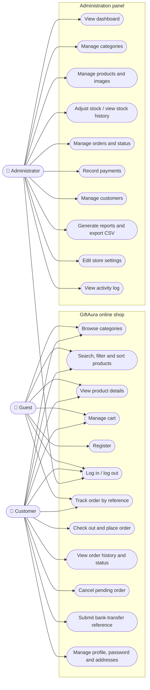
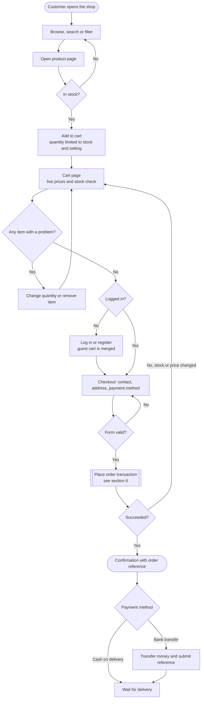
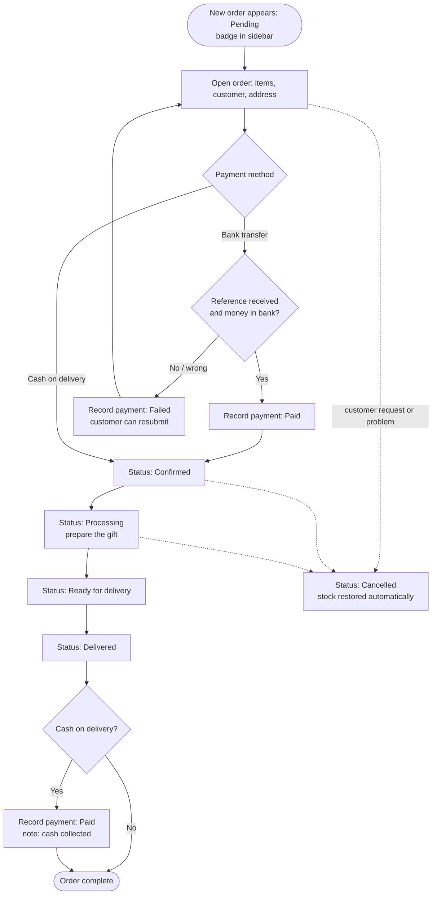
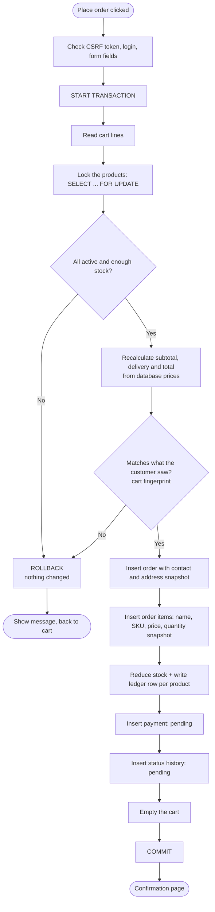
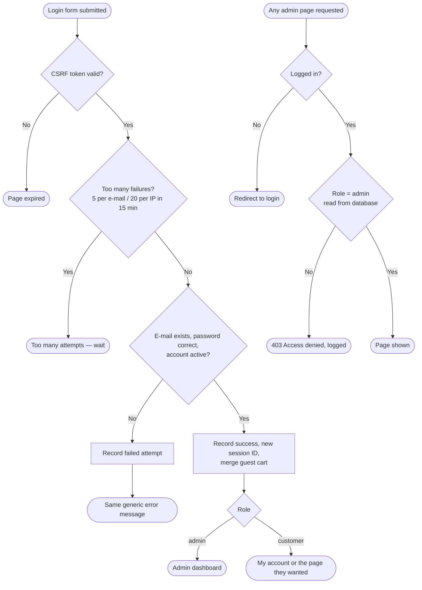
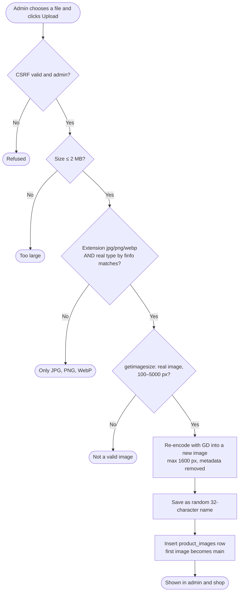
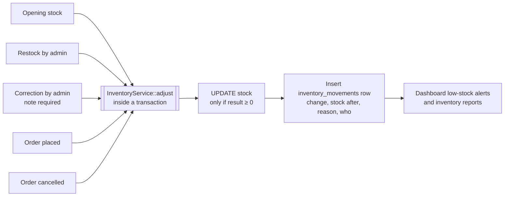

# GiftAura — Use Cases and System Flows

Version 1.0 — Phase 9. The diagrams are written in Mermaid; open `docs/diagrams.html` (double-click) to see them as pictures and download each one as SVG for the report. Every flow below describes the system **as built and tested** (see `docs/test-plan.md`).

## 1. Actors

| Actor | Description |
|---|---|
| Guest | Visitor who is not logged in |
| Customer | Registered user with role `customer` |
| Administrator | Store staff with role `admin` (created only from the command line) |
| System | Server-side logic that runs automatically (totals, stock, history, logs) |

## 2. Use-case diagram

Mermaid has no dedicated UML use-case shape, so actors are drawn as rounded boxes and use cases as ovals (stadium shapes); arrows show which actor can perform each use case. «include» relationships are listed in section 3.

## 3. Use-case descriptions (main cases)

| ID | Use case | Actor | Pre-condition | Main flow | Alternative / exception flows | Post-condition |
|---|---|---|---|---|---|---|
| UC8 | Check out and place order | Customer | Logged in; cart not empty; no cart problems | 1. Open checkout 2. Enter contact details 3. Choose saved or new address 4. Choose payment method 5. Review totals 6. Place order | Invalid field → error shown, nothing saved. Item out of stock / price changed since the page opened → order refused, cart shown again. Administrator → redirected (admins cannot order) | Order, items, payment and history stored; stock reduced; cart emptied; reference shown |
| UC10 | Cancel pending order | Customer | Own order with status Pending | 1. Open order 2. Cancel order 3. Confirm | Order no longer pending (store already started) → refused with message | Status Cancelled; stock restored once; history row |
| UC11 | Submit bank-transfer reference | Customer | Own bank-transfer order; payment pending or failed | 1. Open order 2. Enter reference 3. Send | Invalid characters → refused | Payment "Awaiting verification" |
| UC7 | Track order | Guest / Customer | Has order reference and order e-mail | 1. Enter both 2. Submit | Mismatch → "could not find"; more than 10 lookups in 10 min → wait message | Status and timeline shown (no address) |
| UA3 | Manage products and images | Administrator | Logged in as admin | Add/edit product; upload image; set main image; deactivate | Duplicate slug/SKU, invalid price → errors. Bad image (type, size, fake image) → refused | Product saved; image re-encoded with random name; action logged |
| UA5 | Manage order status | Administrator | Order exists | Choose next allowed status, optional note, save | Not an allowed step → refused. Unpaid bank transfer → confirm only with override | Status changed; history row; cancellation restores stock |
| UA6 | Record payment | Administrator | Order exists | Choose Paid / Failed / Refunded, note, save | Not allowed (e.g. refund before paid, pay a cancelled order) → refused. Refund without note → refused | Payment status, date and admin recorded |
| UA8 | Reports and CSV | Administrator | — | Choose report and date range; optionally Export CSV | Invalid dates → defaults with a message | Figures calculated from records; CSV downloaded |

«include» relationships: *Check out* includes *Log in* and *Manage cart*; *Manage orders* includes *Record payments* (same screen); every administrator use case includes *Log in* with the admin role.

## 4. Customer purchase flow

## 5. Administrator order-fulfilment flow

## 6. Order placement transaction (inside the server)

## 7. Login and access-control flow

## 8. Secure image-upload flow

## 9. Inventory flow (every stock change)

